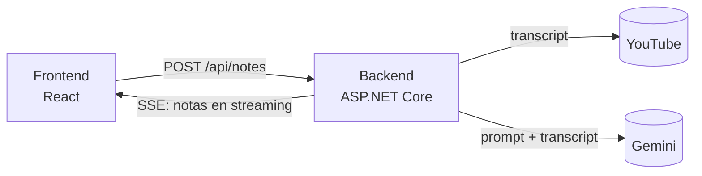

# Notas Net

Pegá el link de un video de YouTube y recibí **notas de estudio en Markdown**, generadas por Gemini y mostradas en vivo mientras se escriben.

> **Demo en vivo:** _se agrega luego del despliegue (ver [docs/deploy.md](docs/deploy.md))_


## Cómo funciona



1. El usuario pega un link; el frontend lo valida.
2. El backend extrae el `videoId`, obtiene el transcript y lo envía a Gemini con un prompt especializado.
3. La respuesta vuelve por **Server-Sent Events** y el frontend renderiza el Markdown a medida que llega.

Más detalle en [docs/architecture.md](docs/architecture.md).

## Stack

- **Backend:** C#, ASP.NET Core (Minimal API), xUnit, `YoutubeExplode`, Gemini REST API
- **Frontend:** React, TypeScript, Vite, Tailwind, `react-markdown`, Vitest + Testing Library
- **Infra:** Docker, GitHub Actions, Azure Container Apps + Static Web Apps + Application Insights

## Correrlo local

```bash
cp .env.example .env        # completá GEMINI_API_KEY
docker compose up --build
# abrir http://localhost:3000
```

Sin Docker: `dotnet run --project backend/src/NotasNet.Api` (con `Gemini__ApiKey` definida) y `npm --prefix frontend run dev`.

Tests: `dotnet test backend` y `npm --prefix frontend test`.

## Decisiones de diseño

- **`ILlmProvider` e `ITranscriptProvider`.** Las dos dependencias externas están detrás de interfaces en `Application`. El caso de uso se testea con fakes, y cambiar de LLM o de fuente de transcript no toca la lógica.
- **SSE en lugar de esperar la respuesta completa.** Las notas de un video largo tardan; mostrar el texto en streaming mejora mucho la experiencia. Como el endpoint es `POST`, el frontend usa `fetch` con lectura de stream en vez de `EventSource`.
- **Clean Architecture ligera.** Un solo proyecto con carpetas `Application` / `Infrastructure` / `Endpoints`. Da separación de responsabilidades sin la sobreingeniería de cuatro proyectos para una app de este tamaño.
- **Map-reduce para videos largos.** Si el transcript supera un umbral, se resume por partes y se genera la nota final sobre esos resúmenes.
- **Protección de costos.** Rate limit por IP, tope de tamaño de transcript y cuota diaria global de llamadas al LLM.

## Limitaciones conocidas

- El transcript se obtiene con una librería no oficial; puede romperse si YouTube cambia su formato y está en una zona gris de sus términos de servicio. Por eso está aislada detrás de `ITranscriptProvider`.
- Los videos sin subtítulos (o privados) no se pueden procesar.
- La cuota diaria se guarda en memoria: se reinicia al reiniciar el contenedor y no se comparte entre réplicas.

## Próximos pasos

- Historial de notas (persistencia con EF Core).
- Cuentas de usuario.
- Fallback enviando el video directamente a Gemini cuando no hay transcript.
