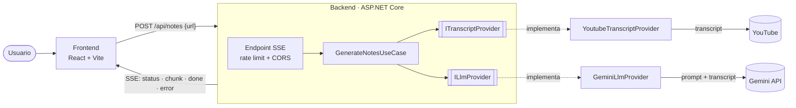

# Arquitectura

## Capas del backend

| Carpeta | Responsabilidad |
|---|---|
| `Endpoints/` | Endpoint HTTP, SSE, cuota diaria |
| `Application/` | Caso de uso, parser de URL, interfaces de proveedores |
| `Infrastructure/` | Implementaciones: YouTube (`YoutubeExplode`) y Gemini (REST) |
| `Prompts/` | Prompt del sistema versionado (recurso embebido) |

## Despliegue

- **Backend:** Azure Container Apps (escala a cero), imagen construida en Azure Container Registry.
- **Frontend:** Azure Static Web Apps.
- **Observabilidad:** Application Insights (se activa al definir `APPLICATIONINSIGHTS_CONNECTION_STRING`).
